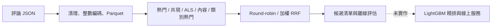

# Amazon Reviews：5.71 億筆評論的單機離線召回系統

以 Amazon Reviews 2023 的評論互動為訊號，完成單機資料管線、多路候選召回與時間切分評估。
**目前完成候選生成；LightGBM 精排、線上 API、延遲 SLO 與 A/B 測試尚未完成。**
評論時間不是購買時間，資料也不是完整交易紀錄。

[圖文報告](reports/web_report.html) · [三位使用者展示](reports/demo/demo.html) ·
[評估協定與重跑方式](docs/evaluation_protocol.md) · [歷史結果紀錄](reports/legacy_results.json) ·
[詳細實驗紀錄](docs/experiment_details.md)

## 30 秒摘要

| 項目 | 摘要 |
|---|---|
| 做了什麼 | 在單一桌機上完成 Amazon Reviews 2023 的資料管線、五路候選召回、加權 RRF 與時間切分離線評估。 |
| 規模多大 | 歷史全量紀錄為 571,544,897 筆原始互動，71.2 GB 轉為 6.0 GB Parquet；這組工程數字未在目前版本重新驗證。 |
| 結果如何 | 凍結設定跨五個時間窗的 Recall@500 相對熱門基線提升 6.1%~20.8%；未受尾端截斷影響的三個 2022 窗平均提升約 9.9%。 |
| 如何避免自我欺騙 | 權重只在 valid 選擇、test 僅執行一次；保存實驗來源並使用 paired bootstrap，同時揭露資料尾端截斷與冷啟動候選偏誤。 |
| 還沒做到什麼 | LightGBM 精排、模型持久化、低延遲索引、線上 API、監控與 A/B 測試。 |

若只看一段：這是一個**候選召回與離線評估系統**，不是已上線的完整推薦產品。
工程規模、離線提升與尚未驗證的線上收益在本文中分開陳述。

## 問題與完成範圍

給定使用者在切分點之前的評論互動，產生候選清單，評估是否包含他在未來時間窗內
首次互動的商品。答案是商品集合，不是嚴格的 next-item，也不代表預測所有購買。
低評分目前仍被當作互動，未建模滿意度；這是隱式訊號的限制。



- 已實作：下載與續傳、資料清理與品質報告、使用者抽樣、五路召回、時間切分、評估。
- 本次修正：ALS 標準 fold-in、使用者／商品雙向分塊 Top-K、嚴格人數抽樣上限、
  加權 RRF、JSON 實驗紀錄、冷商品診斷、paired bootstrap、三位使用者合成展示、
  內容式通道，以及把內容式通道的屬性表改成必須由 `--items` 明確指定。
- 已完成：valid 權重掃描、設定凍結後的一次性 test 執行，以及**五個時間窗的穩健性驗證**（見下）。
- 尚未實作：精排、模型持久化與部署、低延遲索引、線上監控與 A/B 實驗。

## 歷史全量工程結果

以下沿用舊版專案的量測紀錄，**沒有在目前版本重新驗證全量數字**；原始執行 log、完整命令與
資料內容指紋未隨 repo 保存，勿當成新版本 benchmark。2026-09-12 的[驗證紀錄](reports/verification.md)註明當時環境沒有 D 槽資料；
2026-09-15 起的 valid、test 與多窗評估紀錄（`reports/runs/`）則讀取了 1996–2023 共 28 個年度分區的全量互動 Parquet
（路徑遮蔽為 `<external>/interactions`），內容式通道讀取 `D:/amazon-reviews-2023/parquet/items/items.parquet`。
兩者是否為同一台機器，紀錄中無法確定；repo 內也沒有重跑原始 JSON → Parquet 轉檔的紀錄，所以下表仍是舊數字。

| 項目 | 歷史紀錄 |
|---|---:|
| 原始列數 | 571,544,897 |
| 去重後互動 | 564,540,881 |
| 使用者 / 商品 | 54,514,264 / 48,185,153 |
| 類別檔 | 34（33 個正式類別 + Unknown） |
| 時間範圍 | 1996-06-17 ～ 2023-09-14 |
| 壓縮原始檔 → Parquet | 71.2 GB → 6.0 GB |
| 轉檔耗時 | 30.8 分鐘 |
| 原執行環境 | i5-14500、64 GB RAM、無 GPU |

這些數字描述資料處理規模，不代表每個模型都訓練了全部使用者與商品。
舊 ALS 實驗經門檻過濾後，約使用 1,250 萬位使用者、1,152 萬件商品。

工程取捨（去重量測、分階段落地、單機適用範圍、共現成本、整數 ID）見 [詳細實驗紀錄](docs/experiment_details.md)。

## 資料集尾端有嚴重截斷

多窗驗證意外查出一件更根本的事。各時間窗的互動量：

| 評估窗 | 互動數 | 活躍使用者 | 每日互動 | 相對 2022 常態 |
|---|---:|---:|---:|---:|
| 2022-06 | 16,386,089 | 7,144,720 | 178,110 | — |
| 2022-09 | 16,064,898 | 6,449,296 | 176,537 | −1% |
| 2022-12 | 17,226,504 | 6,650,543 | 191,406 | +7% |
| 2023-03 | 11,059,012 | 4,867,999 | 120,207 | **−33%** |
| 2023-06 | 2,991,116 | 1,412,156 | 32,512 | **−82%** |
| 2023-09-01～09-14 | 50,810 | 25,653 | 3,629 | **−98%** |

資料集宣稱涵蓋到 2023-09，但**最後幾個月的資料量是塌的**。這是快照式資料集
常見的採集尾端效應，不是真實的行為變化。

後果很直接：

- **test 窗 `[2023-06-01, 2023-09-10)` 正好落在塌陷區**，每日互動只有 2022 常態的 18%。
- **valid 窗 `[2023-03-01, 2023-06-01)` 也已在衰減區**（−33%）。
- 合格使用者從 590 萬（2022-12）掉到 111 萬（test），平均歷史 24.4 → 4.7、中位數 10 → 3。

也就是說，本專案唯一的留出結果落在一段資料殘缺的時期。
`DEFAULT_SPLIT` 的邊界當初是在**沒有量過各窗資料量**的情況下選的——
這是切分設計的疏漏，多窗驗證才把它暴露出來。

## 多時間窗驗證：方向穩健，幅度不穩

同一組凍結設定（1／1／0.25、seed 42、K=500）換五個時間窗重跑，沒有任何調參。
三個 2022 窗先前從未評估過。紀錄在 `reports/runs/rolling-*.json`。

| 評估窗 | 每日互動 | 熱門 R@500 | 融合 R@500 | 提升 | bootstrap@500 |
|---|---:|---:|---:|---:|---|
| 2022-06 | 178k | 0.03006 | 0.03252 | +8.2% | 顯著 |
| 2022-09 | 177k | 0.02637 | 0.03042 | +15.4% | 顯著 |
| 2022-12 | 191k | 0.02977 | 0.03159 | +6.1% | 顯著 |
| 2023-03（調參窗） | 120k | 0.02532 | 0.03023 | +19.4% | 顯著 |
| 2023-06（test） | 33k | 0.02301 | 0.02778 | +20.8% | 顯著 |

**方向穩健：5 個窗全部為正，paired bootstrap 的 95% CI 全部不跨 0。**

**但幅度不穩，而且偏高的兩個都是有問題的窗：**

- 三個未受截斷影響的 2022 窗：+8.2%、+15.4%、+6.1%，平均 **+9.9%**
- 兩個有問題的窗（一個是調參窗，一個在塌陷區）：+19.4%、+20.8%，平均 +20.1%

**所以 +20.8% 是觀察範圍的頂端，不是典型值。** 較誠實的說法是
「跨五個時間窗提升介於 +6% 到 +21% 且皆顯著，未受資料截斷影響的窗約 +10%」。

而且提升變大主要來自分母退化：融合的絕對值大致穩在 0.028–0.033，
熱門基線卻從 0.03006 一路掉到 0.02301。**不是模型變好，是基線變差。**

**這三個 2022 窗是回測，不是前測。** 權重在 2023-03 選定後套回 2022，
時間上是倒著走的；它證明的是跨時期的穩健性，不是對未來的泛化能力。
真正的前向留出只有 test 那一次，而那一窗的資料是殘缺的。

## 最終 test 結果（設定凍結後執行一次）

權重在 valid 選定為 1／1／0.25 後凍結，test 只跑這一次，沒有回頭調整。
test：歷史 `ts < 2023-06-01`，答案 `[2023-06-01, 2023-09-10)`，20,000 位使用者。
紀錄在 `reports/runs/test-final.json`。

| 加權 RRF 1／1／0.25 | valid | test | 變化 |
|---|---:|---:|---:|
| Recall@10 | 0.00401 | 0.00388 | −3.3% |
| Recall@100 | 0.01252 | 0.01096 | −12.4% |
| Recall@500 | 0.03023 | 0.02778 | **−8.1%** |
| NDCG@500 | 0.00703 | 0.00629 | −10.5% |

絕對數字下降，這是預期的：0.25 是在 valid 上挑出來的。但熱門基線也一起下降，
**相對熱門的提升反而略為擴大**：

| | 熱門 Recall@500 | 融合 Recall@500 | 提升 |
|---|---:|---:|---:|
| valid | 0.02532 | 0.03023 | +19.4% |
| test | 0.02301 | 0.02778 | **+20.8%** |

test 的 paired bootstrap 全部不跨 0：Recall@10 +0.00096 [+0.00041, +0.00151]、
Recall@100 +0.00205 [+0.00141, +0.00270]、Recall@500 +0.00478 [+0.00363, +0.00596]。

**這一節之後不再調整任何參數。** 若要再改設定，必須重新切一段未使用過的時間窗。

test 族群與各通道承受位移、修正後的 valid 成績與權重掃描、召回缺口、內容式通道的冷啟動偏誤、
舊版歷史召回成績，以及 ALS 修正與效能邊界，見 [詳細實驗紀錄](docs/experiment_details.md)。

## 快速開始

需要 Python 3.12 與 uv。版本鎖定於 `uv.lock`。

```bash
uv sync --frozen --extra dev
uv run pytest -m "not network" -ra
uv run python scripts/07_demo.py
```

開啟 `reports/demo/demo.html`。所有商品與互動都明確標為合成，不需下載 71 GB。
若目錄已存在，改用 `--out reports/demo_new`；腳本拒絕覆寫既有結果。
Windows 建議 `PYTHONUTF8=1`，資料目錄可用 `AMAZON_DATA_ROOT` 覆寫。

評估這份合成展示（只驗證流程，不能當模型成績）：

```bash
uv run python scripts/06_recall_eval.py --src reports/demo/interactions --k 10 --eval-ks 10 --temp-dir reports/tmp --output reports/runs/demo-eval.json
```

以全量資料重跑 valid 的命令、通道與權重規則見 [詳細實驗紀錄](docs/experiment_details.md)。

## 測試與限制

測試包括：時間邊界、合格使用者抽樣、已見商品排除、手算 Recall / NDCG、
ALS 正規方程對照、分塊 Top-K 對照完整搜尋、RRF 權重與重複處理、冷商品診斷。

部分原有 ingest 測試需要本機原始資料，缺資料時會 skip；network 測試需另外連線。
以 [本次驗證紀錄](reports/verification.md) 的實際 passed / skipped / deselected 為準，
不使用固定的「75 passing」徽章代替測試結果。

評估只涵蓋有歷史且未來有新互動的使用者，不代表所有訪客。
cutoff 後才出現的商品仍留在答案分母，另列不可達比例。
coverage 改以 cutoff 前可見商品為分母，因此不與舊版全時間目錄 coverage 直接比較。
時間切分不能解決評論選擇偏差，也不保證線上收益。
內容式通道的冷啟動候選有已知偏誤（觸及冷商品的能力被系統性高估），見 [詳細實驗紀錄](docs/experiment_details.md)。

## 專案結構

```text
src/amazon_recsys/
  ingest/       下載、清理、抽樣
  recall/       熱門、共現、ALS、內容、類別熱門、融合
  evaluation/   指標、時間切分、品質、實驗來源
  ranking/      尚未實作
scripts/        資料管線、06_recall_eval.py、07_demo.py
reports/        歷史結果、驗證紀錄、展示
```

資料來源：[Amazon Reviews 2023](https://amazon-reviews-2023.github.io/)，McAuley Lab。
授權：[MIT](LICENSE)。設計文件保留歷史規劃，不代表所有功能已落地。
