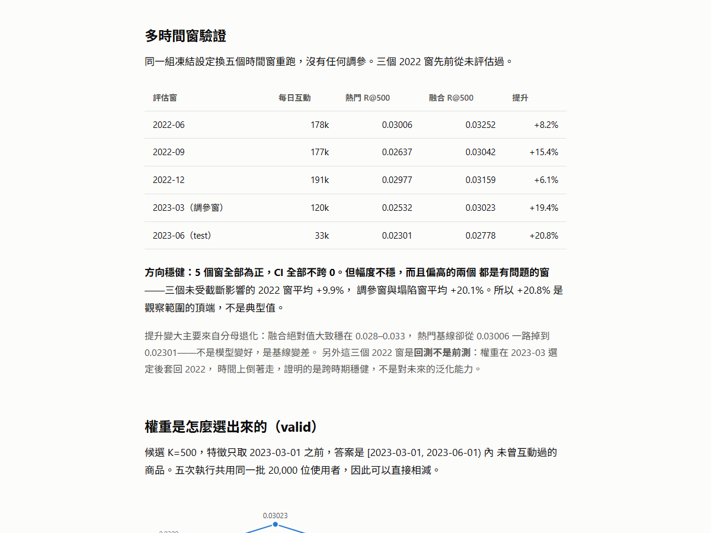
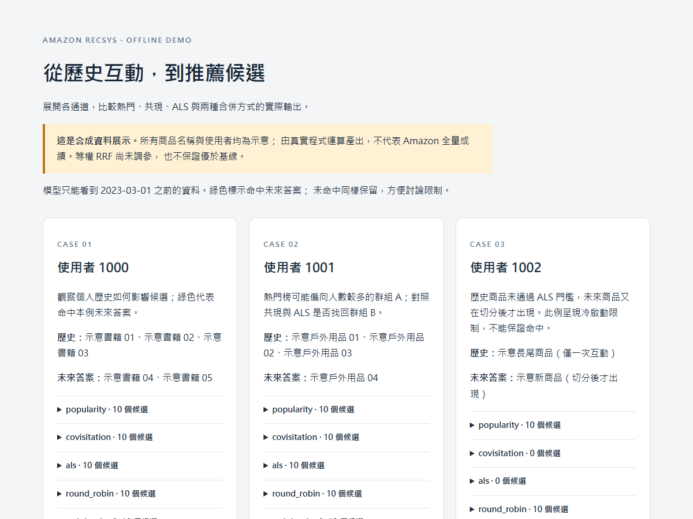
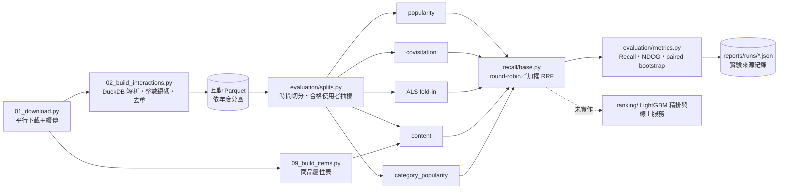

# Amazon Reviews：5.71 億筆評論的單機離線召回系統

在一台無 GPU 的桌機上，把 Amazon Reviews 2023 的評論互動做成資料管線、五路候選召回與加權 RRF 融合，
並用時間切分、paired bootstrap 與多時間窗驗證誠實地量出「比熱門基線好多少」。

> **目前完成候選生成與離線評估；LightGBM 精排、線上 API、延遲 SLO 與 A/B 測試尚未完成。**
> 評論時間不是購買時間，資料也不是完整交易紀錄。

[圖文報告](reports/web_report.html) · [三位使用者展示](reports/demo/demo.html) ·
[評估協定與重跑方式](docs/evaluation_protocol.md) · [詳細實驗紀錄](docs/experiment_details.md) ·
[歷史結果紀錄](reports/legacy_results.json)

## 30 秒摘要

| 項目 | 摘要 |
|---|---|
| 做了什麼 | 單機資料管線（DuckDB → Parquet）、五路候選召回（熱門／共現／ALS／內容／類別熱門）、加權 RRF、時間切分離線評估。 |
| 規模 | 歷史紀錄：571,544,897 筆原始互動，71.2 GB 壓縮原始檔轉為 6.0 GB Parquet（舊紀錄，未在目前版本重新驗證）。 |
| 結果 | 凍結設定跨五個時間窗 Recall@500 相對熱門基線 +6.1%～+20.8%，paired bootstrap 95% CI 全部不跨 0；未受資料截斷影響的三個 2022 窗平均約 +9.9%。 |
| 如何避免自我欺騙 | 權重只在 valid 選擇、test 只執行一次；每次實驗存 JSON 來源紀錄；主動揭露資料尾端截斷與冷啟動候選偏誤。 |
| 還沒做到 | 精排、模型持久化、低延遲索引、線上 API、監控與 A/B 測試。 |

## 要解決的問題

給定使用者在切分點之前的評論互動，產生 500 個候選商品，評估是否包含他在未來時間窗內**首次互動**的商品。
這是兩階段推薦系統的第一階段（召回）：精排救不回召回沒撈到的商品，所以召回的天花板決定了整個系統的上限。
答案是商品集合，不是嚴格的 next-item；低評分目前仍被當作互動，未建模滿意度。

難處在規模與誠實度：歷史紀錄中有約 5,451 萬使用者、4,819 萬商品，要在 64 GB RAM 的單機上處理；
而離線評估很容易因為時間洩漏、在 test 上調參或挑好看的時間窗而高估成效。

## Demo

多時間窗驗證（擷自 [`reports/web_report.html`](reports/web_report.html)，數字來自 `reports/runs/rolling-*.json`）：



不需下載 71 GB 資料的合成展示（`scripts/07_demo.py` 產生的 [`reports/demo/demo.html`](reports/demo/demo.html)；商品與互動皆為合成，只驗證流程）：



## 架構



`scripts/06_recall_eval.py` 串起切分、各通道、融合與評估；`scripts/07_demo.py` 用合成資料跑同一套程式碼。

## 技術重點

- **時間切分防洩漏**（`evaluation/splits.py`）：`TimeSplit` 定義左閉右開的邊界，所有特徵只能取自 `feature_cutoff` 之前；
  內容式通道刻意不用 metadata 的 `average_rating`、`rating_number`（2023-09 彙總值，含未來評論），改由互動表在切分點前重算熱度。
- **加權 RRF 而非比較原始分數**（`recall/base.py`）：各通道的分數不可比，只用名次融合。等權融合會被弱通道拖累，
  所以權重只在 valid 掃描（內容 0.15／0.25／0.35／0.5／1.0），選定 1／1／0.25 後凍結。
- **ALS 標準 fold-in 與分塊 Top-K**（`recall/als.py`）：用 `implicit` 訓練，使用者向量以標準 fold-in（`recalculate_user`）計算，並對照正規方程測試；
  使用者／商品雙向分塊 Top-K 對照完整精確搜尋測試。
- **可追溯的實驗紀錄**（`evaluation/experiment.py`）：每次評估存 JSON（argv、git commit、程式 SHA256、套件版本、資料清單指紋、
  樣本指紋、各通道參數與耗時），不保存 Windows 使用者目錄路徑；既有結果檔拒絕覆寫。
- **診斷「缺口在哪一層」**：`channel_reachability` 量出只有 21.7% 的答案商品存在於共現圖中——
  共現通道碰不到 78.3% 的答案，該修的是圖的覆蓋率，不是融合權重。
- **否定結果也記錄**：類別熱門通道把候選聯集上限推到最高卻交付最少，因此不採用；ALS Top-K 向量化版本反而更慢（0.63x），已還原
  （`reports/verification.md`）。

## 成果與數字

**最終 test（設定凍結後只執行一次）**：歷史 `ts < 2023-06-01`，答案 `[2023-06-01, 2023-09-10)`，20,000 位使用者
（`reports/runs/test-final.json`）。

| | 熱門 Recall@500 | 融合 Recall@500 | 相對提升 | ΔRecall@500 的 95% CI |
|---|---:|---:|---:|---|
| valid | 0.02532 | 0.03023 | +19.4% | — |
| test | 0.02301 | 0.02778 | +20.8% | [+0.00363, +0.00596] |

**多時間窗驗證**（同一組凍結設定，沒有任何調參；`reports/runs/rolling-*.json`）：

| 評估窗 | 每日互動 | 熱門 R@500 | 融合 R@500 | 提升 |
|---|---:|---:|---:|---:|
| 2022-06 | 178k | 0.03006 | 0.03252 | +8.2% |
| 2022-09 | 177k | 0.02637 | 0.03042 | +15.4% |
| 2022-12 | 191k | 0.02977 | 0.03159 | +6.1% |
| 2023-03（調參窗） | 120k | 0.02532 | 0.03023 | +19.4% |
| 2023-06（test） | 33k | 0.02301 | 0.02778 | +20.8% |

- **方向穩健**：5 個窗全部為正，paired bootstrap 95% CI 全部不跨 0。
- **幅度不穩**：偏高的兩個正好是調參窗與資料塌陷窗；較誠實的說法是「未受截斷影響的窗約 +10%」。
  提升變大主要來自熱門基線退化（0.03006 → 0.02301），不是模型變好。
- **2022 窗是回測不是前測**：權重在 2023-03 選定後套回 2022，證明的是跨時期穩健，不是對未來的泛化。

**資料集尾端有嚴重截斷**：多窗驗證查出 2023-03 起互動量相對 2022 常態下降 33%，2023-06 起下降 82%，
2023-09 起下降 98%（各窗互動量表見 `reports/web_report.html`）。test 窗正好落在塌陷區；
`DEFAULT_SPLIT` 當初是在沒有量過各窗資料量的情況下選的，這是切分設計的疏漏。

**召回缺口仍是最大的問題**：Recall@500 約 3.0%，而 cutoff 前目錄的理論上限是 89.7%（`docs/experiment_details.md`）。

**歷史全量工程數字**（沿用舊版 README 的量測紀錄，首次出現於 commit `fdfb3a9`；原始 log 與命令未隨 repo 保存，**未在目前版本重新驗證**）：

| 項目 | 歷史紀錄 |
|---|---:|
| 原始列數 / 去重後互動 | 571,544,897 / 564,540,881 |
| 使用者 / 商品 | 54,514,264 / 48,185,153 |
| 壓縮原始檔 → Parquet | 71.2 GB → 6.0 GB，轉檔 30.8 分鐘 |
| 原執行環境 | i5-14500、64 GB RAM、無 GPU |

這些數字描述資料處理規模，不代表每個模型都訓練了全部使用者與商品。工程取捨（去重量測、分階段落地、共現成本控制）見
[詳細實驗紀錄](docs/experiment_details.md)。

## 如何執行

需要 Python 3.12 與 uv，版本鎖定於 `uv.lock`。Windows 建議設 `PYTHONUTF8=1`。

```bash
uv sync --frozen --extra dev
uv run pytest -m "not network" -ra
uv run python scripts/07_demo.py      # 合成展示，不需下載資料；輸出到 reports/demo/
```

`07_demo.py` 拒絕覆寫既有結果；目錄已存在時加 `--out reports/demo_new`。評估合成展示（只驗證流程，不能當模型成績）：

```bash
uv run python scripts/06_recall_eval.py --src reports/demo/interactions --k 10 --eval-ks 10 --temp-dir reports/tmp --output reports/runs/demo-eval.json
```

全量資料（約 95.7 GB，資料目錄用 `AMAZON_DATA_ROOT` 指定）的下載、轉檔與 valid／test 重跑命令見
[評估協定](docs/evaluation_protocol.md)。

測試：2026-10-30 以 Python 3.12 venv 執行 `pytest -m "not network" -ra`，**111 passed、2 deselected**；
`ruff check src tests scripts` 通過。2 個 deselected 是需要連網的下載／續傳測試。`test_build_interactions.py` 需要本機原始資料，
缺資料時會 skip（歷次結果見 [`reports/verification.md`](reports/verification.md)）。

## 已知限制與下一步

- **唯一的前向留出結果落在資料殘缺期**；要更可信的泛化結論，需要重新選一段未使用過且資料完整的時間窗。
- **內容式通道的冷啟動能力被系統性高估**：冷商品池建自全時間範圍的 `item_map`，等於只收「未來一定會有互動」的商品；
  修正需保留零互動商品，尚未實作。
- 評估只涵蓋有歷史且未來有新互動的使用者；時間切分不能解決評論選擇偏差，也不保證線上收益。
- CI 只衡量抽樣不確定性，未校正權重挑選與多重比較；0.25 與相鄰權重之間沒有做 paired bootstrap。
- 歷史全量工程數字未在目前版本重新驗證。
- 下一步：擴大共現圖覆蓋率（召回缺口在圖本身）→ LightGBM 精排 → 模型持久化與低延遲索引 → 線上服務與 A/B 測試。

## 我負責的部分

獨立完成：需求定義、系統設計、資料管線、各召回通道與融合、評估協定與統計檢定、報告與展示頁、測試與文件。

## 專案結構

```text
src/amazon_recsys/
  ingest/       下載、清理、抽樣、商品屬性表
  recall/       熱門、共現、ALS、內容、類別熱門、融合
  evaluation/   指標、時間切分、資料品質、實驗來源紀錄
  ranking/      尚未實作
scripts/        01–09 資料管線、06_recall_eval.py、07_demo.py
reports/        實驗紀錄（runs/）、驗證紀錄、圖文報告、展示
docs/           評估協定、詳細實驗紀錄、設計文件（保留歷史規劃，不代表所有功能已落地）
```

資料來源：[Amazon Reviews 2023](https://amazon-reviews-2023.github.io/)，McAuley Lab。授權：[MIT](LICENSE)。
